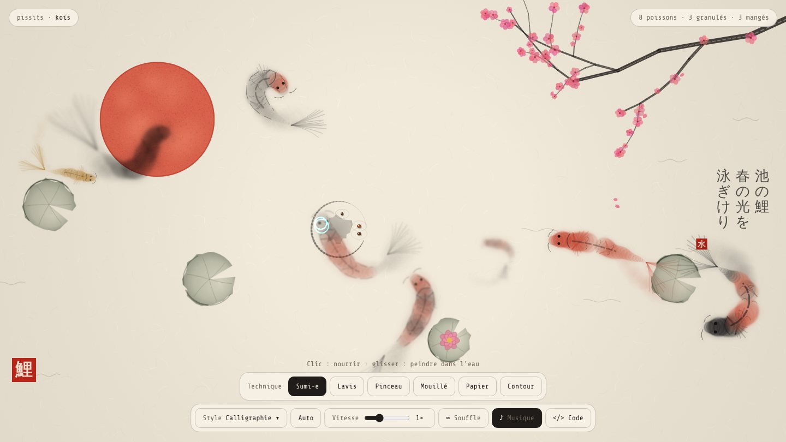

# Koïs

Un bassin de carpes koï animé dans le navigateur, en 18 styles : calligraphie japonaise (sumi-e, lavis, pinceau, mouillé, papier, contour), estampe ukiyo-e, trait d'or, aquarelle, papier découpé, néon, abysses, vitrail, hologramme, thermique, ASCII, code, Matrix, htop, pixel art, mosaïque, encre néon et plan technique.

En ligne : https://koi.pissits.com



- Clic dans l'eau : nourrir les carpes.
- Glisser : peindre un trait dans l'eau, les carpes viennent voir.
- Musique japonaise en fond, coupable avec le bouton ♪.
- Réglage de vitesse et bouton **</> Code** pour lire le moteur directement sur la page.

## Fichiers

| Fichier | Rôle |
| --- | --- |
| `index.html` | La page |
| `css/style.css` | Interface (barres, panneau du code) |
| `js/bassin.js` | Le moteur : poissons, rendus, décor, peinture |
| `js/page.js` | Branche les boutons sur le moteur |
| `fonts/share-tech-mono.woff2` | Police Share Tech Mono (licence SIL OFL 1.1) |
| `audio/musique-1.mp3` … `musique-5.mp3` | Musique japonaise libre de droits, enchaînée en boucle (bouton ♪ pour couper) |

Aucune dépendance, aucune requête externe, aucun traceur. Une politique CSP stricte bloque tout ce qui ne vient pas du site.

## Utiliser le moteur

```html
<canvas id="bassin"></canvas>
<script src="js/bassin.js"></script>
<script>
  const eng = MVBassin.create(document.getElementById('bassin'), { avoid: '[data-evite]', decor: true });
  eng.setStyle('ukiyo');   // MVBassin.STYLES donne la liste complète
  eng.setTech('sumie');    // sumie, lavis, pinceau, mouille, papier, contour
  eng.setSpeed(1.5);       // de 0.2 à 3
</script>
```

## Lancer en local

```sh
python3 -m http.server
```

puis ouvrir http://localhost:8000.

## Licence

Code sous licence [MIT](LICENSE). Police Share Tech Mono sous licence SIL OFL 1.1.

Par Simon · [simonvictor.fr](https://simonvictor.fr)
